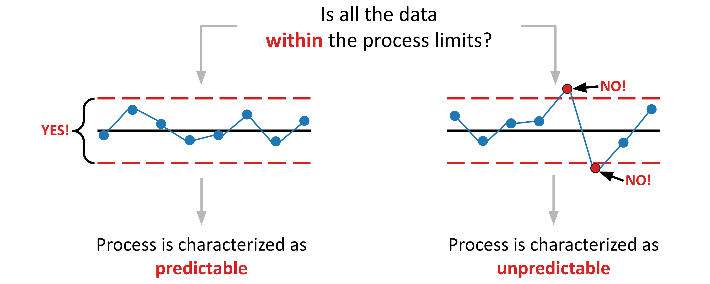

# How to Build an XmR Chart (with Excel) - Part 2

This repository contains the Excel workbook, data, and other supporting files used in The Math Matters Essay **How to Build an XmR Chart (with Excel) - Part 2**.

To read the full essay visit [The Math Matters](https://themathmatters.substack.com/).



## About the Essay

Building on part one of this series found [here](https://themathmatters.substack.com/p/how-to-xmr-chart-with-excel-part2) this essay teaches readers how to apply conditional formatting tables, change the color of markers with values that fall outside the process limits, and characterize process behavior as predictable or unpredictable.

The steps for building an XmR chart in Excel, outlined in part 1, include:

1. Gather the data
2. Establish the spreadsheet structure
3. Calculate the moving ranges
4. Calculate the central lines
5. Calculate the process limits
6. Construct the XmR chart

The essay is practical. As such, readers are encouraged to follow along. Those who do will gain firsthand knowledge of how to construct an XmR chart in Excel.

## Repository Contents

The repository contains the Excel workbook and data used in the essay.

```
├── README.md
├── data/
│   └── silicon-wafer-thickness.csv
├── excel/
│   └── silicon-wafer-thickness-workbook.xlsx
├── figures/
└── README.md
```