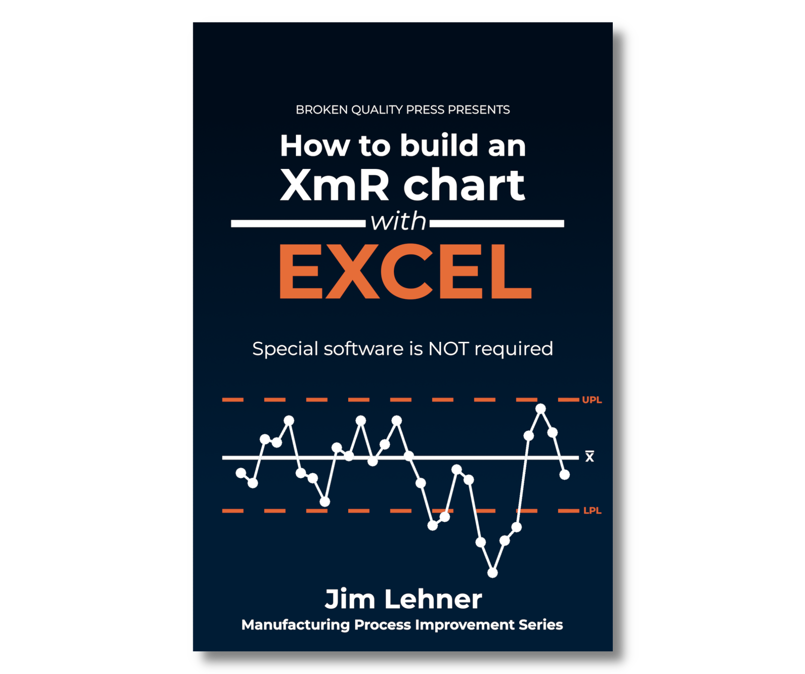

# How to Build an XmR Chart (with Excel) - Part 1

This repository contains the Excel workbook, data, and other supporting files used in The Math Matters Essay **How to Build an XmR Chart (with Excel)**.

To read the full essay visit [The Math Matters](https://themathmatters.substack.com/).


## How to Build an XmR Chart (with Excel) - PDF and EPUB
This two part series has been combined into a single EPUB and PDF that can be downloaded for FREE at (store.brokenquality.com)[https://store.brokenquality.com/b/how-to-xmr-with-excel].



## About the Essay

This essay outlines a 6 step process for constructing an XmR chart using Microsoft Excel.

The steps include:

1. Gather the data
2. Calculate the moving ranges
3. Calculate the average moving range
4. Calculate the mean
5. Calculate the process limits
6. Put it all together (i.e. create the XmR chart)

Readers that follow along using the associated Excel workbook will gain first hand knowledge of how to construct an XmR chart using silicon wafer thickness data.

## Repository Contents

The repository contains the Excel workbook and data used in the essay. A Jupyter Notebook that outlines how to construct the same XmR chart using Python is included in the notebooks folder.

```
├── README.md
├── data/
│   └── silicon-wafer-thickness.csv
├── excel/
│   └── how-to-build-an-xmr.xlsx
├── notebooks/
│   └── silicon-wafer-thickness-xmr.ipynb
└── figures/
    ├── fig_range_A.png
    └── fig_xmr_chart.png
```