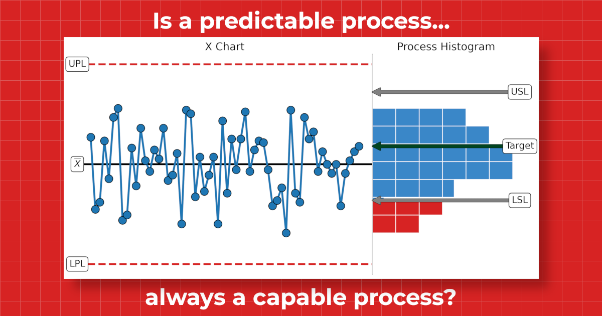

# Is a Predictable Process Always a Capable Process?!

This repository contains the Python code and supporting files used to reproduce select figures for the essay **Is a Predictable Process Always a Capable Process?**.

To read the full essay visit [The Math Matters](https://themathmatters.substack.com/p/is-predictable-always-capable).



## About the Essay

This essay discusses the role that data visualization plays in communicating whether a process is predictable, capable, both, or neither. It describes:

- How to reveal and understand the voice of the process using a process behavior chart
- How to reveal and understand the voice of the customer using a process histogram
- The role that characterization plays in interpreting a process histogram
- How to interpret a data visualization known as a combo chart

## Repository Contents

The repository contains the Python code and data used to reproduce select figures that are presented in the essay.

```
├── README.md
├── data/
│   ├── electrical resistance_measurements.csv
│   ├── fill_weights.csv
│   ├── machine_screw_machine_1.csv
│   ├── machine_screw_machine_2.csv
│   ├── machine_screw_machine_3.csv
    └── magnetic_reciever_depth_of_cut.csv
├── notebooks/
│   └── is-a-predictable-process-always-a-capable-process.ipynb
└── figures/
    ├── F2_resistance_combo_chart.png
    ├── F3_operational_definition.png
    ├── F4_predictable_example.png
    ├── F5_unpredictable_example.png
    ├── F6_wide_narrow_process_histograms.png
    ├── F7_narrow_not_centered_histogram.png
    ├── F8_xmr_and_process_histogram.png
    ├── F9_M2_combo_chart.png
    ├── F10_M3_combo_chart.png
    └── is_predictable_always_capable.png
```