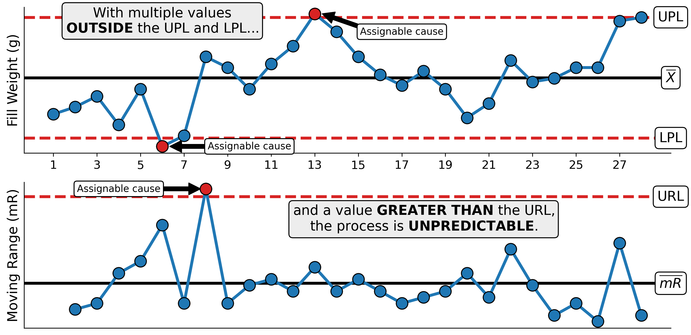

# Predictable or Unpredictable: That is the Question!

This repository contains the Python code and supporting files used to reproduce select figures for the essay **Predictable or Unpredictable: That is the Question!**.

To read the full essay visit [The Math Matters](https://themathmatters.substack.com/).



## About the Essay

The essay outlines a method for interpreting process behavior charts called characterization. Using this method, a process is characterized as either predictable or unpredictable based on the relationship of the data to the process limits. Also called control limits or natural process limits, process limits define how large or small a value must be before it represents a departure from the historic mean. After reading the esssay you will understand:   

- How to characterize process behavior (predictable or unpredictable)
- The kinds of variation that influence process behavior relative to characterization
- How responding to a predictable process differs from an unpredictable process
- A flowchart outlining the logic of characterization

## Repository Contents

The repository contains the Python code and data used to reproduce select figures that are presented in the essay.

```
├── README.md
├── data/
│   ├── fill_weights.csv
│   ├── machine_screw_manufacturing.csv
    └── magnetic_reciever_depth_of_cut.csv
├── notebooks/
│   └── predictable-or-unpredictable.ipynb
└── figures/
    ├── fig_range_A.png
    ├── fig_range_B.png
    ├── fig_stdev.png
    ├── fig_stdev.png
    ├── fill_weights_labeled.png
    ├── screw_machine_xmr.png
    └── screw_machine_xmr_labeled.png
```