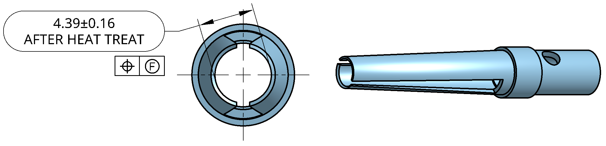

# Same Parts, New Supplier

This repository contains the Python code and supporting files used to reproduce select figures for the essay **Same Parts, New Supplier**.

To read the full essay visit [The Math Matters](https://themathmatters.substack.com/).



## About the Essay

This essay uses socket contact inner diameter (ID) measurements to evaluate if a new supplier 

- Characterize the underlying causal system with an XmR chart
- Evaluate the voice of the customer with a process histogram
- Calculate the process capability indices

## Repository Contents

The repository contains the Python code and data used to reproduce figures that are presented in the essay.

```
├── README.md
├── data/
│   ├── hydrix-cell-voltage.csv
│   └── piston-cylinder-outer-diameters.csv
├── notebooks/
│   └── numerical-summaries-part-1-measures-of-location.ipynb
└── figures/
    ├── fig_predictable_distributions.png
    ├── fig_socket_contact.png
    ├── fig_unpredictable_distributions.png
    └── fig_.png
```